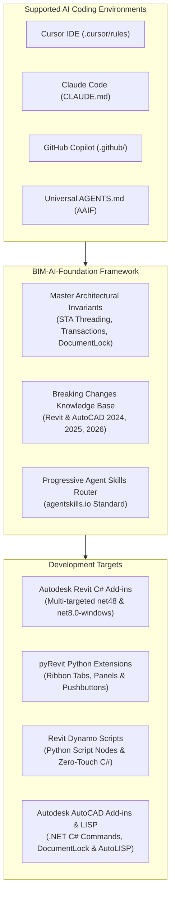

# BIM-AI-Foundation
### An Open-Source Engineering & Knowledge Framework for AI-Assisted BIM & CAD Software Development

[](https://opensource.org/licenses/MIT)
[](https://www.autodesk.com/products/revit)
[](https://www.autodesk.com/products/autocad)
[](https://dynamobim.org/)
[-purple.svg)](https://dotnet.microsoft.com/)
[-orange.svg)](https://github.com/eirannejad/pyRevit)
[](https://agentskills.io)

---

## Executive Overview

**BIM-AI-Foundation** is an open-source development and knowledge framework engineered to provide AI coding assistants (Claude Code, Cursor IDE, GitHub Copilot, OpenAI Codex, Windsurf, Antigravity) with authoritative domain intelligence for AEC software engineering across **Autodesk Revit**, **Revit Dynamo**, and **Autodesk AutoCAD**.

Developing tools for BIM and CAD platforms requires strict adherence to complex API invariants:
- **Thread Safety:** Single-Threaded Apartment (STA) main UI thread isolation across Revit and AutoCAD.
- **Database & Locking:** Scoped Revit transactions, Dynamo `TransactionManager`, and AutoCAD `DocumentLock` / `BlockTableRecord` lifecycles.
- **Version Transitions:** The historic architectural migration from .NET Framework 4.8 (2024) to .NET 8.0 Core (2025/2026) across both Revit and AutoCAD.
- **Type Evolution:** 64-bit `ElementId.Value` (`long`) and `ForgeTypeId` parameter standards.

Without specialized context, standard LLMs regularly generate code that triggers fatal application crashes, memory leaks, or compilation failures. **BIM-AI-Foundation** bridges this domain gap by providing structured rules, dynamic agent skills, and production templates that guide AI models to write correct, high-performance C#, Python, and AutoLISP code on the first attempt.

---

## Core Capabilities



* **Deterministic Architectural Guidance:** Eliminates LLM hallucinations around Revit & AutoCAD STA threading, transaction lifetimes, and document locking.
* **Multi-Platform Support:** First-class engineering intelligence for **Revit C# Add-ins**, **pyRevit Python Extensions**, **Dynamo Computational Graphs**, and **AutoCAD .NET & AutoLISP**.
* **Cross-Compilation (.NET 4.8 & .NET 8):** Unified project templates compiling natively for 2024 (.NET Framework 4.8) and 2025/2026 (.NET 8.0) from a single codebase.
* **Progressive Disclosure Skills:** 11 modular agent skills adhering to the [agentskills.io](https://agentskills.io) standard, reducing AI context overhead by up to 90%.
* **Developer Tooling CLI:** A cross-platform utility (`cli/bim-ai.ps1`) to scaffold add-ins, inject rules into existing projects, and statically validate codebases for Revit and AutoCAD API anti-patterns.

---

## Repository Architecture

```text
BIM-AI-Foundation/
├── AGENTS.md                          # Open-standard master AI rules (AAIF standard)
├── CLAUDE.md                          # Claude Code CLI configuration
├── .cursorrules                       # Cursor IDE root rules
├── .windsurfrules                     # Windsurf IDE configuration
├── .cursor/rules/                     # Modular Cursor rules (.mdc)
│   ├── revit-core.mdc                 # Revit STA threading and transaction invariants
│   ├── autocad-core.mdc               # AutoCAD DocumentLock and database transaction rules
│   ├── dynamo-core.mdc                # Dynamo TransactionManager and element unwrapping
│   ├── revit-versions.mdc             # Version-specific compilation (.NET 4.8 vs .NET 8)
│   ├── revit-architecture.mdc         # Clean Architecture & MVVM design patterns
│   └── bim-skills-router.mdc          # Dynamic skill dispatch router
├── .github/copilot-instructions.md    # GitHub Copilot workspace instructions
├── knowledge/                         # Technical knowledge repository
│   ├── INDEX.md                       # High-density knowledge retrieval index
│   ├── breaking-changes-matrix.md     # Comparative API matrix (2024 vs 2025 vs 2026)
│   ├── revit-api/                     # Deep technical references (Threading, Geometry, pyRevit, Dynamo)
│   ├── autocad/                       # AutoCAD .NET API architecture, DocumentLock & AutoLISP
│   ├── versions/                      # Version-specific API guides (2024, 2025, 2026)
│   └── architecture/                  # Clean Architecture, MVVM, and Dependency Injection
├── skills/                            # On-demand Agent Skills (agentskills.io standard)
│   ├── revit-plugin-scaffold/         # Multi-version Revit C# add-in scaffolding
│   ├── revit-pyrevit-extension/       # pyRevit extensions, buttons (.pushbutton) & bundle.yaml
│   ├── revit-dynamo-script/           # Dynamo Python nodes, TransactionManager & Zero-Touch C#
│   ├── autocad-plugin-scaffold/       # AutoCAD .NET add-ins (C#), Commands & AutoLISP (.lsp)
│   ├── revit-external-event/          # Async dispatching & RevitTask completion sources
│   ├── revit-parameter-manager/       # ForgeTypeId, SpecTypeId & unit conversion
│   ├── revit-element-collector/       # High-performance FilteredElementCollector recipes
│   ├── revit-geometry-analysis/       # Solids, Boolean operations & ray casting
│   ├── revit-failure-handler/         # Warning suppression & IFailuresPreprocessor
│   ├── revit-model-validation/        # Model audits & QA/QC validation routines
│   └── revit-dockable-panel/          # Custom dockable panels & WPF MVVM palettes
├── templates/                         # Production-ready starting templates
│   ├── CleanRevitAddin/               # Multi-version Revit C# solution (2024–2026)
│   ├── CleanAutoCADAddin/             # Multi-version AutoCAD C# solution (2024–2026)
│   ├── pyRevitExtension/              # Modular pyRevit extension bundle with pushbuttons
│   └── DynamoScripts/                 # Defensive Dynamo Python node scripts
├── cli/                               # Automation & developer CLI
│   ├── bim-ai.ps1                     # PowerShell core CLI
│   ├── bim-ai.sh                      # Unix/Bash wrapper
│   └── bim-ai.cmd                     # Windows batch wrapper
├── docs/                              # Framework documentation
│   ├── ARCHITECTURE.md                # Structural system design
│   ├── MULTI_AI_GUIDE.md              # Multi-AI editor configuration guide
│   └── TOKEN_OPTIMIZATION.md          # Context token optimization benchmarks
├── CONTRIBUTING.md                    # Contribution guidelines
├── LICENSE                            # MIT License
└── README.md                          # Repository documentation
```

---

## Agent Skills Catalog

Agent skills provide AI assistants with procedural workflows, reusable source implementations, and API signatures on demand:

| Skill | Primary Scope | Provided Assets |
| :--- | :--- | :--- |
| **`revit-plugin-scaffold`** | Scaffolds multi-targeted Revit C# add-ins with SDK-style `.csproj`. | SDK `.csproj`, `.addin` manifest, multi-target build tasks. |
| **`revit-pyrevit-extension`** | Creates pyRevit extensions, custom Ribbon buttons, and UI. | Folder hierarchy, `bundle.yaml`, `script.py` templates. |
| **`revit-dynamo-script`** | Authors Dynamo Python nodes and Zero-Touch C# libraries. | `RevitServices`, `TransactionManager`, defensive list lacing. |
| **`autocad-plugin-scaffold`** | Builds AutoCAD .NET plugins (C#) and AutoLISP routines. | `DocumentLock`, `BlockTableRecord`, Autoloader bundle. |
| **`revit-external-event`** | Dispatches non-blocking async and WPF actions to Revit's STA thread. | `RevitTask.cs`, `ExternalEventWrapper.cs`. |
| **`revit-parameter-manager`** | High-performance, type-safe parameter manipulation using `ForgeTypeId`. | `ParameterExtensions.cs`. |
| **`revit-element-collector`** | Fast element filtering using native C++ quick filters. | `CollectorExtensions.cs`. |
| **`revit-geometry-analysis`** | Solid geometry evaluation, boolean intersections, and ray casting. | `GeometryUtils.cs`. |
| **`revit-failure-handler`** | Automatic warning suppression and transaction failure preprocessors. | `WarningSwallower.cs`, `FailureHandlers.cs`. |
| **`revit-model-validation`** | Comprehensive model health checks and automated QA/QC routines. | `ModelValidator.cs`. |
| **`revit-dockable-panel`** | Custom dockable panels and palettes with WPF MVVM. | `DockablePanelTemplate.xaml`, ViewModels. |

---

## Developer Quickstart

### 1. Scaffolding a New Revit C# Add-in
```powershell
pwsh ./cli/bim-ai.ps1 new -Name "SmartClashAutomation" -Type "csharp" -TargetDir "C:\Projects"
```
Build across supported releases:
```bash
dotnet build -f net48 -c "Release R24"          # Revit 2024 (.NET Framework 4.8)
dotnet build -f net8.0-windows -c "Release R25" # Revit 2025 (.NET 8.0)
dotnet build -f net8.0-windows -c "Release R26" # Revit 2026 (.NET 8.0)
```

---

### 2. Scaffolding a pyRevit Python Extension
```powershell
pwsh ./cli/bim-ai.ps1 new -Name "CustomBimTools" -Type "pyrevit" -TargetDir "C:\Projects"
```
Place in `%APPDATA%\pyRevit\Extensions\` or use `pyrevit extend ui CustomBimTools "C:\Projects"`, then click **Reload** in Revit.

---

### 3. Scaffolding an AutoCAD .NET Plugin (C# & AutoLISP)
```powershell
pwsh ./cli/bim-ai.ps1 new -Name "AcadCivilTools" -Type "autocad" -TargetDir "C:\Projects"
```
Build for your target AutoCAD version:
```bash
dotnet build -f net48           # AutoCAD 2024 (.NET Framework 4.8)
dotnet build -f net8.0-windows  # AutoCAD 2025/2026 (.NET 8.0)
```

---

### 4. Scaffolding a Dynamo Python Workspace
```powershell
pwsh ./cli/bim-ai.ps1 new -Name "DynamoAutomation" -Type "dynamo" -TargetDir "C:\Projects"
```
Provides production-ready Dynamo Python node templates with defensive input unwrapping, `RevitServices` transactions, and geometry interop.

---

### 5. Integrating with Existing Repositories
Inject `BIM-AI-Foundation` rules and skills into any existing plugin, Dynamo, or AutoCAD workspace:
```powershell
pwsh ./cli/bim-ai.ps1 init -TargetDir "C:\Path\To\Your\ExistingProject"
```

---

### 6. Codebase Static Validation
Scan C#, Python, and AutoLISP files for common API bugs, obsolete signatures, and threading issues:
```powershell
pwsh ./cli/bim-ai.ps1 validate -TargetDir "C:\Path\To\Your\Project"
```

---

## Technical Standards & Version Support

| Software | Version | Target Framework | Key Architectural Invariants |
| :--- | :--- | :--- | :--- |
| **Autodesk Revit** | **2024** | `net48` | `ElementId.Value` (Int64), introduction of `Toposolid`. |
| **Autodesk Revit** | **2025 / 2026** | `net8.0-windows` | **.NET 8.0 Core**, SDK-style csproj, `AssemblyLoadContext` isolation. |
| **Autodesk AutoCAD** | **2024** | `net48` | .NET Framework 4.8, `DocumentLock`, `BlockTableRecord`. |
| **Autodesk AutoCAD** | **2025 / 2026** | `net8.0-windows` | **.NET 8.0 Core**, modernized graphics pipeline. |
| **Revit Dynamo** | **2.x / 3.x** | CPython 3 / IronPython | `RevitServices.Transactions.TransactionManager`, `UnwrapElement`. |

---

## Roadmap

- [x] Master AI architecture and progressive skill router
- [x] Autodesk Revit 2024, 2025, and 2026 multi-version compatibility
- [x] C# Clean Architecture multi-target template (.NET 4.8 / .NET 8.0)
- [x] pyRevit Python extension and Ribbon button scaffolding
- [x] Autodesk Revit Dynamo Python node scripting and templates
- [x] Autodesk AutoCAD .NET C# plugin scaffolding and AutoLISP rules
- [x] Automation CLI for installation, multi-type scaffolding, and validation
- [ ] Autodesk Civil 3D API rules and alignment/corridor skills
- [ ] Autodesk Navisworks clash and coordination plugin skills
- [ ] Tekla Structures Open API integration
- [ ] OpenBIM / IFC processing rules (IfcOpenShell & Xbim)

---

## Contributing

Contributions are welcomed from the AEC software engineering community. Please review [CONTRIBUTING.md](CONTRIBUTING.md) for details on submitting new Agent Skills, expanding knowledge base documentation, or adding framework templates.

---

## License

This repository is distributed under the terms of the [MIT License](LICENSE).

---

## Repository Access

* **GitHub Repository:** [https://github.com/AbhishekAbhishek1/BIM-AI-Foundation](https://github.com/AbhishekAbhishek1/BIM-AI-Foundation)
* **Clone:**
  ```bash
  git clone https://github.com/AbhishekAbhishek1/BIM-AI-Foundation.git
  ```
