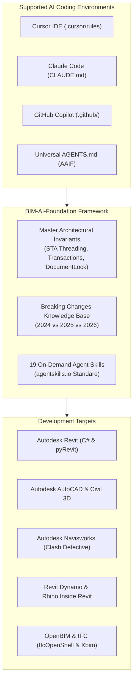

# BIM-AI-Foundation
### An Open-Source Engineering & Knowledge Framework for AI-Assisted BIM & CAD Software Development

[](https://opensource.org/licenses/MIT)
[](https://github.com/Abhishekaggarwal1/BIM-AI-Foundation/actions)
[](https://www.autodesk.com/products/revit)
[](https://www.autodesk.com/products/autocad)
[](https://www.autodesk.com/products/navisworks)
[](https://www.autodesk.com/products/civil-3d)
[](https://www.buildingsmart.org/)
[](https://dynamobim.org/)
[-purple.svg)](https://dotnet.microsoft.com/)
[-orange.svg)](https://github.com/eirannejad/pyRevit)
[](https://agentskills.io)

---

## Executive Overview

**BIM-AI-Foundation** is an open-source development and knowledge framework engineered to provide AI coding assistants (Claude Code, Cursor IDE, GitHub Copilot, OpenAI Codex, Windsurf, Antigravity) with authoritative domain intelligence for AEC software engineering across **Autodesk Revit**, **AutoCAD**, **Navisworks**, **Civil 3D**, **Revit Dynamo**, **Rhino.Inside.Revit**, and **OpenBIM / IFC**.

Developing tools for BIM and CAD platforms requires strict adherence to complex API invariants:
- **Thread Safety:** Single-Threaded Apartment (STA) main UI thread isolation across Revit and AutoCAD.
- **Database & Locking:** Scoped Revit transactions, Dynamo `TransactionManager`, and AutoCAD `DocumentLock` / `BlockTableRecord` lifecycles.
- **Version Transitions:** The historic architectural migration from .NET Framework 4.8 (2024) to .NET 8.0 Core (2025/2026) across Revit, AutoCAD, and Navisworks.
- **Type Evolution:** 64-bit `ElementId.Value` (`long`) and `ForgeTypeId` parameter standards.
- **Open Standards:** buildingSMART IFC4/4.3 schemas, IDS validation, and BCF issue exchange.

Without specialized context, standard LLMs regularly generate code that triggers fatal application crashes, memory leaks, or compilation failures. **BIM-AI-Foundation** bridges this domain gap by providing structured rules, dynamic agent skills, and production templates that guide AI models to write correct, high-performance C#, Python, and AutoLISP code on the first attempt.

---

## Core Capabilities



* **Deterministic Architectural Guidance:** Eliminates LLM hallucinations around Revit & AutoCAD STA threading, transaction lifetimes, and document locking.
* **Full AEC Platform Scope:** Intelligence for **Revit C# Add-ins**, **pyRevit Extensions**, **Dynamo Nodes**, **AutoCAD & Civil 3D .NET**, **Navisworks Clash Detective**, **Rhino.Inside.Revit**, and **OpenBIM / IFC**.
* **Cross-Compilation (.NET 4.8 & .NET 8):** Unified project templates compiling natively for 2024 (.NET Framework 4.8) and 2025/2026 (.NET 8.0) from a single codebase.
* **Automated CI/CD Workflows:** Built-in GitHub Actions (`.github/workflows/ci.yml`) validating and compiling templates automatically.
* **Progressive Disclosure Skills:** 19 modular agent skills adhering to the [agentskills.io](https://agentskills.io) standard, reducing AI context overhead by up to 90%.
* **Developer Tooling CLI:** A cross-platform utility (`cli/bim-ai.ps1`) to scaffold add-ins, inject rules into existing projects, and statically validate codebases.

---

## Agent Skills Catalog

Agent skills provide AI assistants with procedural workflows, reusable source implementations, and API signatures on demand:

| Domain | Skill | Scope & Assets |
| :--- | :--- | :--- |
| **Revit Core** | **`revit-plugin-scaffold`** | Scaffolds multi-targeted Revit C# add-ins with SDK-style `.csproj`. |
| **Revit UI & Python**| **`revit-pyrevit-extension`** | Creates pyRevit extensions, custom Ribbon buttons, `bundle.yaml`, and forms. |
| **Revit Dynamo** | **`revit-dynamo-script`** | Authors Dynamo Python nodes, `RevitServices` transactions, and Zero-Touch C#. |
| **AutoCAD** | **`autocad-plugin-scaffold`** | Builds AutoCAD .NET plugins (C#), `DocumentLock`, and AutoLISP routines. |
| **Civil 3D** | **`civil3d-plugin-scaffold`** | Queries `CivilDocument`, Alignments, Profiles, TIN Surfaces, and Corridors. |
| **Navisworks** | **`navisworks-plugin-scaffold`**| Automates Navisworks Clash Detective tests, SelectionSets, and Viewpoints. |
| **OpenBIM / IFC** | **`openbim-ifc-processing`** | Parses IFC files, extracts Psets/Qto, and validates IDS via `IfcOpenShell` & `Xbim`. |
| **Computational** | **`rhino-inside-revit`** | Bridges RhinoCommon with Revit API, converting Breps to DirectShape in Grasshopper. |
| **Testing** | **`revit-unit-testing`** | In-process and decoupled automated unit testing with `xUnitRevit` & TestRunner. |
| **Coordination** | **`bim-bcf-manager`** | Generates BCF 2.1/3.0 XML and REST issues with 3D camera viewpoints. |
| **Content** | **`revit-family-automator`** | Automates family documents (.rfa), `FamilyManager`, formulas, and parameters. |
| **Cloud Automation** | **`aps-design-automation`** | Headless cloud Revit batch processing via Autodesk Platform Services (APS). |
| **Async / UI** | **`revit-external-event`** | Non-blocking async and WPF dispatching via `RevitTask.cs`. |
| **Data & Units** | **`revit-parameter-manager`** | Type-safe parameter manipulation using modern `ForgeTypeId`. |
| **Filtering** | **`revit-element-collector`** | Fast element filtering using native C++ quick filters. |
| **Geometry** | **`revit-geometry-analysis`** | Solid geometry evaluation, boolean intersections, and ray casting. |
| **Failures** | **`revit-failure-handler`** | Automatic warning suppression and transaction failure preprocessors. |
| **Auditing** | **`revit-model-validation`** | Comprehensive model health checks and automated QA/QC routines. |
| **Dockable Panels** | **`revit-dockable-panel`** | Custom dockable panels and palettes with WPF MVVM. |

---

## Developer Quickstart

### 1. Scaffolding Projects via CLI

You can run commands using PowerShell 7 (`pwsh`), Windows PowerShell (`powershell -ExecutionPolicy Bypass -File`), or CMD (`cli\bim-ai.cmd`):

```powershell
# Revit C# Add-in (Revit 2024-2026)
pwsh ./cli/bim-ai.ps1 new -Name "SmartClash" -Type "csharp"

# pyRevit Python Extension
pwsh ./cli/bim-ai.ps1 new -Name "CustomBimTools" -Type "pyrevit"

# AutoCAD .NET Plugin (AutoCAD 2024-2026)
pwsh ./cli/bim-ai.ps1 new -Name "AcadTools" -Type "autocad"

# Navisworks Manage Add-in (Navisworks 2024-2026)
pwsh ./cli/bim-ai.ps1 new -Name "NavisAuditor" -Type "navisworks"

# Dynamo Python Scripts Workspace
pwsh ./cli/bim-ai.ps1 new -Name "DynamoScripts" -Type "dynamo"

# OpenBIM IFC Tools Workspace
pwsh ./cli/bim-ai.ps1 new -Name "IfcAutomation" -Type "openbim"

# (Windows CMD / PowerShell 5.1 alternative)
# .\cli\bim-ai.cmd new -Name "SmartClash" -Type "csharp"
```

---

### 2. Static Codebase Validation

Scan C#, Python, and AutoLISP files for common API bugs, obsolete signatures, and threading issues:
```powershell
pwsh ./cli/bim-ai.ps1 validate -TargetDir "C:\Path\To\Your\Project"
```

---

### 3. Integrating with Existing Repositories

Inject `BIM-AI-Foundation` rules and skills into any existing plugin, Dynamo, or CAD workspace:
```powershell
pwsh ./cli/bim-ai.ps1 init -TargetDir "C:\Path\To\Your\ExistingProject"
```

---

## Technical Standards & Version Support

| Software | Version | Target Framework | Key Architectural Invariants |
| :--- | :--- | :--- | :--- |
| **Autodesk Revit** | **2024** | `net48` | `ElementId.Value` (Int64), introduction of `Toposolid`. |
| **Autodesk Revit** | **2025 / 2026** | `net8.0-windows` | **.NET 8.0 Core**, SDK-style csproj, `AssemblyLoadContext` isolation. |
| **Autodesk AutoCAD** | **2024** | `net48` | .NET Framework 4.8, `DocumentLock`, `BlockTableRecord`. |
| **Autodesk AutoCAD** | **2025 / 2026** | `net8.0-windows` | **.NET 8.0 Core**, modernized graphics pipeline. |
| **Autodesk Navisworks** | **2024–2026**| `net48` / `net8.0-windows` | `DocumentClash`, `ModelItem` selection tree, `AddInPlugin`. |
| **Autodesk Civil 3D** | **2024–2026**| `net48` / `net8.0-windows` | `CivilDocument`, Alignments, Profiles, TIN Surfaces. |
| **Revit Dynamo** | **2.x / 3.x** | CPython 3 / IronPython | `RevitServices.Transactions.TransactionManager`, `UnwrapElement`. |
| **OpenBIM / IFC** | **2X3 / 4 / 4.3** | Python / .NET 8 | `IfcOpenShell`, `Xbim`, buildingSMART IDS schema compliance. |

---

## Roadmap

- [x] Master AI architecture and progressive skill router
- [x] Autodesk Revit 2024, 2025, and 2026 multi-version compatibility
- [x] C# Clean Architecture multi-target template (.NET 4.8 / .NET 8.0)
- [x] pyRevit Python extension and Ribbon button scaffolding
- [x] Autodesk Revit Dynamo Python node scripting and templates
- [x] Autodesk AutoCAD .NET C# plugin scaffolding and AutoLISP rules
- [x] Autodesk Navisworks Manage clash automation and add-in scaffolding
- [x] Autodesk Civil 3D infrastructure API rules and alignment/corridor skills
- [x] OpenBIM & IFC processing (IfcOpenShell & Xbim)
- [x] Rhino.Inside.Revit & Grasshopper computational pipelines
- [x] Automated Unit Testing skills (xUnitRevit & TestRunner)
- [x] BIM Collaboration Format (BCF 2.1 & 3.0) issue manager
- [x] Revit Family (.rfa) document & parameter automation
- [x] APS (Forge) Design Automation for headless cloud Revit
- [x] GitHub Actions automated CI/CD pipeline
- [ ] Tekla Structures Open API integration

---

## Contributing

Contributions are welcomed from the AEC software engineering community. Please review [CONTRIBUTING.md](CONTRIBUTING.md) for details on submitting new Agent Skills, expanding knowledge base documentation, or adding framework templates.

---

## License

This repository is distributed under the terms of the [MIT License](LICENSE).

---

## Repository Access

* **GitHub Repository:** [https://github.com/Abhishekaggarwal1/BIM-AI-Foundation](https://github.com/Abhishekaggarwal1/BIM-AI-Foundation)
* **Clone:**
  ```bash
  git clone https://github.com/Abhishekaggarwal1/BIM-AI-Foundation.git
  ```
