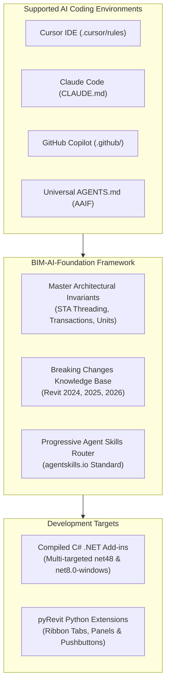

# BIM-AI-Foundation
### An Open-Source Engineering & Knowledge Framework for AI-Assisted BIM Software Development

[](https://opensource.org/licenses/MIT)
[](https://www.autodesk.com/products/revit)
[-purple.svg)](https://dotnet.microsoft.com/)
[-orange.svg)](https://github.com/eirannejad/pyRevit)
[](https://agentskills.io)

---

## Executive Overview

**BIM-AI-Foundation** is an open-source development and knowledge framework engineered to provide AI coding assistants (Claude Code, Cursor IDE, GitHub Copilot, OpenAI Codex, Windsurf, Antigravity) with authoritative domain intelligence for Autodesk Revit software engineering.

Building software for Building Information Modeling (BIM) platforms requires strict adherence to complex API invariants:
- **Thread Safety:** Single-Threaded Apartment (STA) main UI thread isolation.
- **Database Integrity:** Scoped transactions, transaction groups, and failure preprocessing.
- **Version Transitions:** The major architectural migration from .NET Framework 4.8 (Revit 2024) to .NET 8.0 Core (Revit 2025/2026).
- **Type Evolution:** 64-bit `ElementId.Value` (`long`) and `ForgeTypeId` parameter/unit standards.

Without specialized context, standard LLMs regularly generate code that triggers fatal application crashes, memory leaks, or compilation failures. **BIM-AI-Foundation** bridges this domain gap by providing structured rules, dynamic agent skills, and production templates that guide AI models to write correct, high-performance C# and Python code on the first attempt.

---

## Core Capabilities



* **Deterministic Architectural Guidance:** Eliminates LLM hallucinations around Revit STA threading, transaction lifetimes, and warning popups.
* **Dual-Language Ecosystem:** Native, first-class support for both compiled **C# (.NET)** plugins and interpreted **Python (pyRevit)** extensions.
* **Multi-Version Cross-Compilation:** A unified C# project structure that compiles natively for Revit 2024 (.NET Framework 4.8), Revit 2025 (.NET 8.0), and Revit 2026 (.NET 8.0) from a single codebase.
* **Progressive Disclosure Skills:** Modular, on-demand agent skills adhering to the [agentskills.io](https://agentskills.io) standard, reducing AI context overhead by up to 90%.
* **Developer Tooling CLI:** A cross-platform PowerShell utility (`cli/bim-ai.ps1`) to scaffold add-ins, inject rules into existing projects, and statically validate codebases for Revit API anti-patterns.

---

## Repository Architecture

```text
BIM-AI-Foundation/
├── AGENTS.md                          # Open-standard master AI rules (AAIF standard)
├── CLAUDE.md                          # Claude Code CLI configuration
├── .cursorrules                       # Cursor IDE root rules
├── .windsurfrules                     # Windsurf IDE configuration
├── .cursor/rules/                     # Modular Cursor rules (.mdc)
│   ├── revit-core.mdc                 # Threading and database transaction invariants
│   ├── revit-versions.mdc             # Version-specific compilation (.NET 4.8 vs .NET 8)
│   ├── revit-architecture.mdc         # Clean Architecture & MVVM design patterns
│   └── bim-skills-router.mdc          # Dynamic skill dispatch router
├── .github/copilot-instructions.md    # GitHub Copilot workspace instructions
├── knowledge/                         # Technical knowledge repository
│   ├── INDEX.md                       # High-density knowledge retrieval index
│   ├── breaking-changes-matrix.md     # Comparative API matrix (2024 vs 2025 vs 2026)
│   ├── revit-api/                     # Deep technical references (Threading, Geometry, pyRevit)
│   ├── versions/                      # Version-specific API guides (2024, 2025, 2026)
│   └── architecture/                  # Clean Architecture, MVVM, and Dependency Injection
├── skills/                            # On-demand Agent Skills (agentskills.io standard)
│   ├── revit-plugin-scaffold/         # Multi-version C# add-in scaffolding
│   ├── revit-pyrevit-extension/       # pyRevit extensions, buttons (.pushbutton) & bundle.yaml
│   ├── revit-external-event/          # Async dispatching & RevitTask completion sources
│   ├── revit-parameter-manager/       # ForgeTypeId, SpecTypeId & unit conversion
│   ├── revit-element-collector/       # High-performance FilteredElementCollector recipes
│   ├── revit-geometry-analysis/       # Solids, Boolean operations & ray casting
│   ├── revit-failure-handler/         # Warning suppression & IFailuresPreprocessor
│   ├── revit-model-validation/        # Model audits & QA/QC validation routines
│   └── revit-dockable-panel/          # Custom dockable panels & WPF MVVM palettes
├── templates/                         # Production-ready starting templates
│   ├── CleanRevitAddin/               # Multi-version C# solution (Revit 2024–2026)
│   └── pyRevitExtension/              # Modular pyRevit extension bundle with pushbuttons
├── cli/                               # Automation & developer CLI
│   ├── bim-ai.ps1                     # PowerShell core CLI
│   ├── bim-ai.sh                      # Unix/Bash wrapper
│   └── bim-ai.cmd                     # Windows batch wrapper
├── docs/                              # Framework documentation
│   ├── ARCHITECTURE.md                # Structural system design
│   ├── MULTI_AI_GUIDE.md              # Multi-AI editor configuration guide
│   └── TOKEN_OPTIMIZATION.md          # Context token optimization benchmarks
├── CONTRIBUTING.md                    # Contribution guidelines
├── LICENSE                            # MIT License
└── README.md                          # Repository documentation
```

---

## Agent Skills Catalog

Agent skills provide AI assistants with procedural workflows, reusable source implementations, and API signatures on demand:

| Skill | Primary Scope | Provided Assets |
| :--- | :--- | :--- |
| **`revit-plugin-scaffold`** | Scaffolds multi-targeted C# add-ins with SDK-style `.csproj`. | SDK `.csproj`, `.addin` manifest, multi-target build tasks. |
| **`revit-pyrevit-extension`** | Creates pyRevit extensions, custom Ribbon buttons, and UI. | Folder hierarchy, `bundle.yaml`, `script.py` templates. |
| **`revit-external-event`** | Dispatches non-blocking async and WPF actions to Revit's STA thread. | `RevitTask.cs`, `ExternalEventWrapper.cs`. |
| **`revit-parameter-manager`** | High-performance, type-safe parameter manipulation using `ForgeTypeId`. | `ParameterExtensions.cs`. |
| **`revit-element-collector`** | Fast element filtering using native C++ quick filters. | `CollectorExtensions.cs`. |
| **`revit-geometry-analysis`** | Solid geometry evaluation, boolean intersections, and ray casting. | `GeometryUtils.cs`. |
| **`revit-failure-handler`** | Automatic warning suppression and transaction failure preprocessors. | `WarningSwallower.cs`, `FailureHandlers.cs`. |
| **`revit-model-validation`** | Comprehensive model health checks and automated QA/QC routines. | `ModelValidator.cs`. |
| **`revit-dockable-panel`** | Custom dockable panels and palettes with WPF MVVM. | `DockablePanelTemplate.xaml`, ViewModels. |

---

## Developer Quickstart

### 1. Scaffolding a New C# .NET Add-in (Revit 2024–2026)

Generate a production-ready, multi-targeted C# solution pre-configured with Clean Architecture and all AI instructions:

```powershell
pwsh ./cli/bim-ai.ps1 new -Name "SmartClashAutomation" -Type "csharp" -TargetDir "C:\Projects"
```

Open the scaffolded directory in **Cursor**, **VS Code**, or **Visual Studio**:
```bash
# Build across all target versions:
dotnet build C:\Projects\SmartClashAutomation\SmartClashAutomation.sln

# Target a specific Revit release:
dotnet build -f net48 -c "Release R24"          # Revit 2024 (.NET Framework 4.8)
dotnet build -f net8.0-windows -c "Release R25" # Revit 2025 (.NET 8.0)
dotnet build -f net8.0-windows -c "Release R26" # Revit 2026 (.NET 8.0)
```

---

### 2. Scaffolding a pyRevit Python Extension

Generate a turnkey pyRevit extension configured with standard ribbon tabs, panels, and pushbuttons:

```powershell
pwsh ./cli/bim-ai.ps1 new -Name "CustomBimTools" -Type "pyrevit" -TargetDir "C:\Projects"
```

1. Deploy to pyRevit via CLI:
   ```bash
   pyrevit extend ui CustomBimTools "C:\Projects"
   ```
2. Or copy the `CustomBimTools.extension` directory directly into `%APPDATA%\pyRevit\Extensions\`.
3. Click **Reload** in Revit's pyRevit tab to activate your custom ribbon buttons.

---

### 3. Integrating with Existing Repositories

To equip an existing Revit add-in or pyRevit project with BIM-AI-Foundation instructions and skills:

```powershell
pwsh ./cli/bim-ai.ps1 init -TargetDir "C:\Path\To\Your\ExistingProject"
```

This injects `AGENTS.md`, `.cursor/rules/`, `.github/copilot-instructions.md`, and the `skills/` catalog directly into your workspace.

---

### 4. Codebase Static Validation

Scan existing C# or Python source files for common Revit API bugs, obsolete signatures, and threading issues:

```powershell
pwsh ./cli/bim-ai.ps1 validate -TargetDir "C:\Path\To\Your\Project"
```

The validator detects:
* Deprecated 32-bit `ElementId.IntegerValue` usage (enforcing 64-bit `ElementId.Value`).
* Obsolete `ParameterType` and `DisplayUnitType` references (enforcing `ForgeTypeId`).
* Threading violations (e.g., executing Revit API methods inside unmanaged `Task.Run()` calls).

---

## Multi-AI Configuration Matrix

| Tool | Integration Anchor | Behavior |
| :--- | :--- | :--- |
| **Cursor IDE** | `.cursor/rules/*.mdc` & `.cursorrules` | Automatically applies modular rules based on file context (`.cs`, `.py`, `.xaml`). |
| **Claude Code** | `CLAUDE.md` | Loads master constraints and progressive disclosure skills on demand. |
| **GitHub Copilot** | `.github/copilot-instructions.md` | Enforces STA threading and modern API conventions in completions and chat. |
| **Windsurf IDE** | `.windsurfrules` | Guides Windsurf cascade workflows with Revit domain laws. |
| **Codex / Universal**| `AGENTS.md` | Universal standard recognized across agentic coding platforms (AAIF specification). |

---

## Technical Standards & Version Support

| Autodesk Revit Version | Target Framework | Runtime Architecture | Notable API Considerations |
| :--- | :--- | :--- | :--- |
| **Revit 2024** | `net48` | .NET Framework 4.8 | `ElementId.Value` (Int64), introduction of `Toposolid`. |
| **Revit 2025** | `net8.0-windows` | **.NET 8.0 (.NET Core)** | SDK-style project format required; `AssemblyLoadContext` isolation; new `FindParameter()` API. |
| **Revit 2026** | `net8.0-windows` | **.NET 8.0 (.NET Core)** | Enhanced Toposolid geometry APIs; cloud collaboration endpoints. |

---

## Roadmap

- [x] Master AI architecture and progressive skill router
- [x] Autodesk Revit 2024, 2025, and 2026 multi-version compatibility
- [x] C# Clean Architecture multi-target template (.NET 4.8 / .NET 8.0)
- [x] pyRevit Python extension and Ribbon button scaffolding
- [x] Automation CLI for installation, scaffolding, and validation
- [ ] Autodesk Civil 3D API rules and alignment/corridor skills
- [ ] Autodesk Navisworks clash and coordination plugin skills
- [ ] Tekla Structures Open API integration
- [ ] OpenBIM / IFC processing rules (IfcOpenShell & Xbim)

---

## Contributing

Contributions are welcomed from the AEC software engineering community. Please review [CONTRIBUTING.md](CONTRIBUTING.md) for details on submitting new Agent Skills, expanding knowledge base documentation, or adding framework templates.

---

## License

This repository is distributed under the terms of the [MIT License](LICENSE).

---

## Repository Access

* **GitHub Repository:** [https://github.com/AbhishekAbhishek1/BIM-AI-Foundation](https://github.com/AbhishekAbhishek1/BIM-AI-Foundation)
* **Clone:**
  ```bash
  git clone https://github.com/AbhishekAbhishek1/BIM-AI-Foundation.git
  ```
